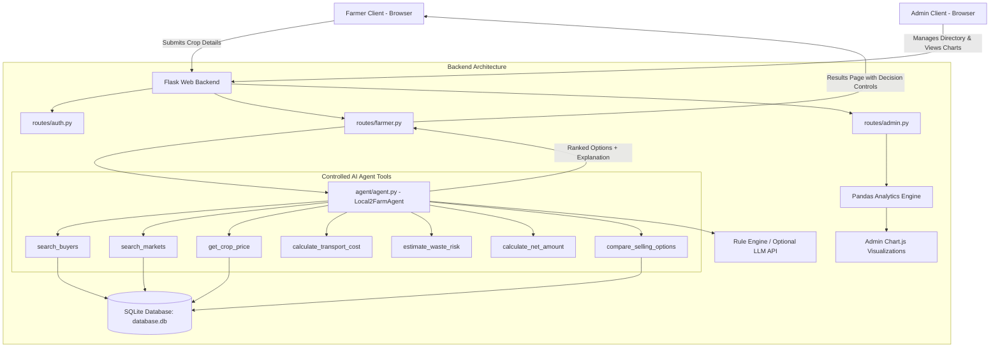
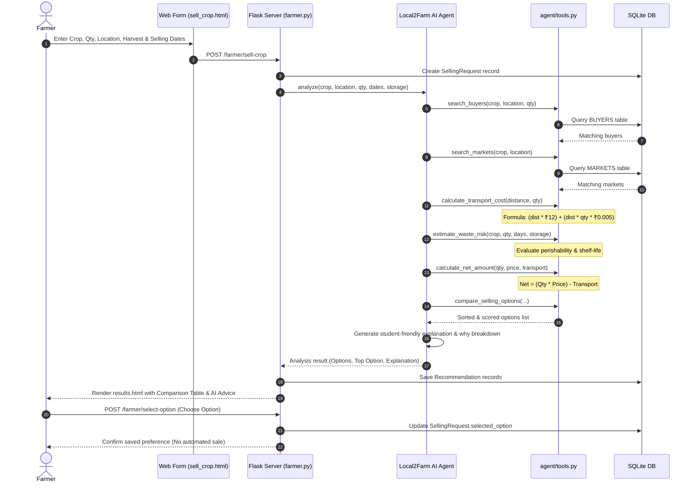
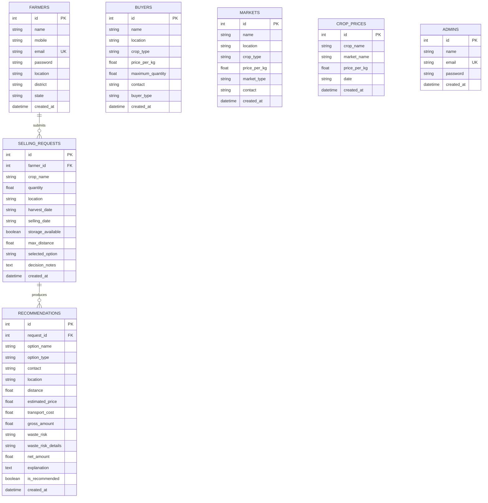

# Local2Farm: An AI Agent for Helping Farmers Sell Their Crops

> **Academic Final-Year B.Tech Capstone Project**  
> *A Practical Decision-Support System Empowering Farmers to Choose Optimal Selling Channels.*

---

## 1. Project Title
**Local2Farm: An AI Agent for Helping Farmers Sell Their Crops**

---

## 2. Project Abstract
Small and marginal farmers often struggle to determine whether they should sell their harvested produce to local village aggregators, nearby food processing factories, or travel to distant APMC wholesale market yards (*mandis*). While wholesale market yards may quote higher gross prices per kilogram, high transportation expenses and transit spoilage risks often diminish or eliminate the actual net profit. 

**Local2Farm** is a student-friendly, explainable AI-powered web application built with Python Flask, SQLite, and an isolated AI Agent tool architecture. Farmers input their crop type, quantity, farm location, harvest date, and expected selling date. The **Local2Farm AI Agent** coordinates seven dedicated Python tools to fetch buyer inquiries, market yard rates, road freight costs, and perishability waste risk. It then evaluates and ranks all viable selling channels, presenting the farmer with an estimated net take-home calculation, a clear plain-language advisory explanation, and a detailed "Why this option?" breakdown. 

**Core Principle:** *The AI Agent acts strictly as a decision-support advisory system. The farmer always retains complete autonomy and makes the final decision.*

---

## 3. Problem Statement
1. **Misleading Gross Prices:** Farmers are frequently attracted by higher mandi headline rates without realizing that vehicle hire, fuel, and loading costs can outweigh the price difference.
2. **Perishability & Post-Harvest Losses:** Highly perishable vegetables (such as tomatoes, chillies, and brinjals) degrade rapidly during multi-day holding or transit, causing severe financial loss when storage facilities are unavailable.
3. **Information Asymmetry:** Farmers lack immediate visibility into local food processing units, direct retail buyers, and regional co-operatives that might offer better net margins right at their doorstep.
4. **Over-Complication in Existing AI Systems:** Many academic projects propose overly complex deep-learning black boxes, autonomous trading bots, or IoT networks that are impractical, unexplainable, and unaffordable for actual farming communities.

---

## 4. Project Objectives
- Build a lightweight, easy-to-use web application for farmers using Python Flask, SQLite, HTML5, CSS3, and Bootstrap.
- Implement an **AI Agent Architecture** governed by seven isolated, transparent Python tools.
- Calculate **Estimated Net Amount** factoring in road distance, transport base costs, and weight factors.
- Formulate an explainable rule-based **Estimated Waste Risk** metric based on crop perishability, storage conditions, and harvest timelines.
- Compare multiple buyers and markets, ranking options to maximize farmer net earnings.
- Provide a dual-mode AI engine: **Demo Mode** (deterministic rule-based explanation requiring no external API key) and **LLM API Mode** (pluggable with OpenAI, Gemini, or Groq).
- Implement an **Administrator Dashboard** with Pandas analytics and interactive Chart.js visualizations.

---

## 5. Existing System vs. Proposed System

| Feature | Existing System | Proposed Local2Farm System |
| :--- | :--- | :--- |
| **Market Information** | Word of mouth, manual phone calls, or fragmented mandi notice boards | Centralized, searchable directory of verified buyers and market yards |
| **Logistics Evaluation** | Mental guess; freight costs rarely calculated beforehand | Automatic road freight calculation based on distance and quantity |
| **Spoilage Risk** | Unmonitored; risk often leads to distress sales | Rule-based Estimated Waste Risk based on crop shelf-life and storage |
| **Financial Metric** | Focuses only on Gross Price (₹/kg) | Computes **Estimated Net Take-Home Pay** after deducting transport |
| **AI Transparency** | Black-box models or non-explainable outputs | Step-by-step tool execution trace with friendly, transparent explanation |
| **User Control** | Often theoretical automated trading | **Decision Support Only:** Farmer always makes the final decision |

---

## 6. Key Features

### For the Farmer:
1. **Simple Registration & Login:** Clean registration with name, mobile, email, village/city, district, and state with secure password hashing.
2. **Farmer Dashboard:** Quick glance at total requests submitted, recent crop analyses, available buyers, and available markets.
3. **"Sell My Crop" Form:** Intuitive submission of crop type, quantity (kg), harvest date, selling date, max distance, and storage availability.
4. **AI Agent Comparison Table:** Side-by-side comparison of options with Price/kg, Road Distance, Transport Cost, Gross Return, Estimated Net Return, and Waste Risk badge.
5. **AI Advisory Explanation:** Friendly plain-language explanation comparing trade-offs between nearby buyers and distant mandis.
6. **"Why this option?" Breakdown:** Structured breakdown answering why the recommended channel is advantageous across price, transport, waste, and net earnings.
7. **Farmer Decision Preference:** Ability to choose their preferred channel without any automated transaction or lock-in.
8. **Request History:** Permanent log of all past crop requests and decisions.

### For the Administrator:
1. **Admin Dashboard:** Real-time metrics on registered farmers, buyers, markets, and total requests.
2. **Chart.js Visualizations (Powered by Pandas):**
   - Bar chart of crop request frequency.
   - Doughnut chart of most requested crop share.
   - Bar/Line chart of benchmark crop market rates.
3. **Buyers Management (CRUD):** Add, edit, and delete buyers with contact details, buyer types, and maximum intake quantity.
4. **Markets Management (CRUD):** Add, edit, and delete APMC market yards and rythu bazars.
5. **Crop Benchmark Prices (CRUD):** Update daily baseline rates for crops across regional trading centers.
6. **Audited Requests Log:** Full table view of all farmer requests across the platform.

---

## 7. Technology Stack

- **Frontend:**
  - HTML5 & CSS3
  - Bootstrap 5.3 (Mobile-responsive UI)
  - Bootstrap Icons
  - Vanilla JavaScript
- **Backend:**
  - Python 3.10+ (Tested on Python 3.14)
  - Flask (Modular Blueprints architecture)
  - Werkzeug (Secure password hashing)
- **Database:**
  - SQLite (`database.db`)
  - Flask-SQLAlchemy (ORM with parameterized SQL protection)
- **AI Agent & Reasoning:**
  - Python-based controlled AI Agent
  - 7 isolated Tool functions
  - Rule-based decision-support engine
  - Pluggable LLM interface (OpenAI / Gemini compatible)
- **Data Processing & Analytics:**
  - Pandas (Aggregation, frequency analysis, and price averages)
- **Data Visualization:**
  - Chart.js (Interactive client-side charts)
- **Development & Testing:**
  - Python `unittest` test suite
  - VS Code friendly layout

---

## 8. System Architecture



---

## 9. AI Agent Workflow



---

## 10. Database Design

The database schema uses six relational tables managed via SQLite and SQLAlchemy:



---

## 11. Explanation of AI Agent Tools (Section 9 & 10)

The AI Agent does not execute raw SQL queries directly. Instead, it interacts via seven modular Python functions located in `agent/tools.py`:

1. **`search_buyers(crop, location, quantity)`**  
   Searches the database for buyers who accept the given crop variety and have sufficient purchasing capacity. Estimates road distance to the buyer.
2. **`search_markets(crop, location)`**  
   Locates APMC market yards, sub-mandis, or rythu bazars trading the crop within the specified region.
3. **`get_crop_price(crop, market_or_buyer)`**  
   Retrieves current benchmark rates from the `CROP_PRICES` table.
4. **`calculate_transport_cost(distance, quantity)`**  
   Applies a configurable freight formula:  
   $$\text{Transport Cost} = \max\left(300, (\text{Distance} \times 12) + (\text{Distance} \times \text{Quantity} \times 0.005)\right)$$
   Guarantees a realistic ₹300 minimum dispatch cost.
5. **`estimate_waste_risk(crop, quantity, harvest_date, selling_date, storage_available)`**  
   Evaluates transit/holding days against crop perishability:
   - **Highly Perishable** (*Tomato, Chilli, Brinjal, Cabbage*):  
     - 0–1 day: **Low Risk**
     - 2–3 days: **Medium Risk** (Low if storage available)
     - 4+ days: **High Risk** (Medium if storage available)
   - **Durable Crops** (*Potato, Onion, Carrot*):  
     - 0–3 days: **Low Risk**
     - 4–7 days: **Medium Risk**
     - 8+ days: **High Risk**
6. **`calculate_net_amount(quantity, price_per_kg, transport_cost)`**  
   Computes financial returns:  
   $$\text{Gross Amount} = \text{Quantity} \times \text{Price per kg}$$  
   $$\text{Net Amount} = \text{Gross Amount} - \text{Transport Cost}$$
7. **`compare_selling_options(...)`**  
   Aggregates buyer and market channels, applies safety weightings for high perishability risks, ranks the results, and marks the top recommendation.

---

## 12. Project Folder Structure

```
Local2Farm/
│
├── app.py                      # Flask Application Factory & Server Entry Point
├── config.py                   # Central Application & AI Configuration
├── requirements.txt            # Python Dependencies
├── database.db                 # SQLite Database (Auto-created & pre-seeded)
├── README.md                   # Full B.Tech Project Documentation
├── .env                        # Local Environment Variables
├── .env.example                # Environment Template
│
├── models/                     # SQLAlchemy Database Models
│   ├── __init__.py             # Exports db and all models
│   ├── farmer.py               # Farmer and Admin accounts
│   ├── buyer.py                # Verified buyers directory
│   ├── market.py               # Mandis & Rythu Bazars directory
│   ├── crop.py                 # Benchmark daily crop prices
│   └── selling_request.py      # Farmer requests & AI recommendations
│
├── agent/                      # AI Agent Core
│   ├── __init__.py             # Agent exports
│   ├── agent.py                # Local2FarmAgent class & reasoning engine
│   └── tools.py                # 7 controlled Python tools
│
├── routes/                     # Flask Modular Blueprints
│   ├── __init__.py             # Exports blueprints
│   ├── auth.py                 # Registration, Login (Farmer/Admin), Sessions
│   ├── farmer.py               # Farmer dashboard, Sell Crop, Results, History
│   └── admin.py                # Admin dashboard, CRUD endpoints, Pandas analytics
│
├── templates/                  # Jinja2 HTML5 Templates (Bootstrap 5)
│   ├── base.html               # Base layout, navbar, flash alerts, footer
│   ├── index.html              # Homepage with workflow and demo helper
│   ├── login.html              # Dual login (Farmer / Admin) with 1-click demo filler
│   ├── register.html           # Farmer registration form
│   ├── farmer_dashboard.html   # Farmer metrics, recent requests & quick links
│   ├── sell_crop.html          # "Sell My Crop" submission form
│   ├── results.html            # AI Agent results, comparison table & decisions
│   ├── history.html            # Farmer historical requests log
│   ├── profile.html            # Farmer profile view and edit
│   ├── admin_dashboard.html    # Admin stats & Chart.js charts
│   ├── buyers.html             # Buyers CRUD management & modals
│   ├── markets.html            # Markets CRUD management & modals
│   ├── crop_prices.html        # Benchmark prices CRUD management
│   ├── farmers_list.html       # Registered farmers directory
│   └── requests_list.html      # System-wide requests audit log
│
├── static/                     # Static Web Assets
│   ├── css/
│   │   └── style.css           # Custom agricultural theme styles
│   └── js/
│       └── script.js           # UI utilities & 1-click demo fillers
│
├── data/                       # Seed & Demo Data
│   ├── __init__.py
│   └── sample_data.py          # Realistic Indian agricultural demo seeder
│
└── tests/                      # Automated Test Suite
    └── test_local2farm.py      # Unit & Integration tests (100% pass)
```

---

## 13. Installation & Setup Steps

### Prerequisites
- Python 3.10, 3.11, 3.12, 3.13, or 3.14
- Operating System: Windows, macOS, or Linux
- Web Browser (Chrome, Edge, Firefox)

### Step 1: Navigate to Project Directory
```powershell
cd C:\Users\lab\.gemini\antigravity\scratch\Local2Farm
```

### Step 2: (Optional) Create and Activate Virtual Environment
```powershell
python -m venv venv
# On Windows PowerShell:
.\venv\Scripts\Activate.ps1
# On Linux / macOS:
source venv/bin/activate
```

### Step 3: Install Required Dependencies
```powershell
pip install -r requirements.txt
```

### Step 4: Verify Environment Configuration
The project is pre-configured with a `.env` file set to `DEMO_MODE=True`.  
*(If you wish to use an external OpenAI/Gemini API key, set `DEMO_MODE=False` and supply `LLM_API_KEY=your_key_here` in `.env`).*

---

## 14. How to Run the Application

Start the Flask development server:
```powershell
python app.py
```

Output:
```
=======================================================
 Local2Farm: AI Decision Support for Farmers
 Final-Year B.Tech Project
 Web Server running on: http://127.0.0.1:5000
 Demo Farmer: ramesh@farmer.com | farmer123
 Demo Admin:  admin@local2farm.com | admin123
=======================================================
```

Open your web browser and navigate to:  
👉 **`http://127.0.0.1:5000`**

---

## 15. Demo Credentials

| Role | Email Address | Password | Pre-loaded Data |
| :--- | :--- | :--- | :--- |
| **Farmer** | `ramesh@farmer.com` | `farmer123` | Ramesh Kumar, Vijayawada, Krishna District |
| **Farmer 2** | `lakshmi@farmer.com` | `farmer123` | Lakshmi Devi, Guntur District |
| **Administrator** | `admin@local2farm.com` | `admin123` | Full access to CRUD, Analytics, and Auditing |

> **Pro Tip:** On the Login page (`/login`), click the **"Fill Farmer"** or **"Fill Admin"** buttons to automatically fill in demo credentials with a single click.

---

## 16. How to Run Automated Unit Tests

Run the comprehensive test suite to verify models, tools, AI logic, and Flask endpoints:
```powershell
python -m unittest tests/test_local2farm.py
```
Expected output:
```
.....
----------------------------------------------------------------------
Ran 5 tests in ~3.5s

OK
```

---

## 17. How the AI Agent Works (Explained in Simple Language)

1. **Hearing the Farmer's Need:**  
   The farmer inputs their crop, volume, and when it will be ready.
2. **Calling Specialized Tools (No Guesswork):**  
   Instead of hallucinating answers, the agent calls separate Python functions:
   - Tool 1 checks who wants to buy the crop right now.
   - Tool 2 checks wholesale government market yards nearby.
   - Tool 4 calculates how much a mini-truck will charge for the round trip.
   - Tool 5 checks whether the crop will spoil if delayed.
3. **Doing the Real Math:**  
   The agent calculates take-home cash:  
   *(Quantity × Rate) minus Fuel & Transport Cost.*
4. **Drafting a Friendly Advisory:**  
   The agent writes a plain-language summary:  
   *"The market yard in Guntur offers ₹23.80/kg, but transport will cost ₹578. Swarna Food Processing in your town offers ₹22.00/kg with only ₹372 transport. Direct selling saves you fuel and avoids tomato spoilage."*
5. **Leaving the Final Call to the Farmer:**  
   The system offers a `[Choose This Option]` button to record the farmer's preference, with a reminder that no automated sale takes place.

---

## 18. Project Limitations (Section 21)

To ensure this capstone project remains explainable, practical, and beginner-friendly, the following features are intentionally out of scope:
- **No Automated Buying/Selling:** The platform does not force or automatically execute financial trades.
- **No Payment Gateway / Escrow:** Avoids banking regulations and financial risk.
- **No Live GPS Vehicle Tracking:** Uses realistic distance matrices rather than commercial vehicle telematics.
- **No Google Maps API Key Requirement:** Avoids third-party billing requirements during academic evaluation.
- **No Heavy Deep Learning / Neural Networks:** Relies on transparent, explainable decision-support tools.
- **No IoT / Drone Hardware:** Operates purely as accessible software for any standard smartphone or PC browser.

---

## 19. Future Enhancements
- **Regional Language Audio Support:** Text-to-speech advisory in Telugu, Hindi, and Tamil for rural farmers.
- **WhatsApp Bot Integration:** Allow farmers to send harvest details via WhatsApp messages.
- **Cold Storage Directory & Booking:** Enable farmers to locate and book vacant slots in nearby cold storages.
- **Shared Transport Pooling:** Group multiple farmers from the same village to share vehicle hire costs.

---

## 20. Conclusion
**Local2Farm** addresses the primary economic challenge faced by Indian farmers: determining the most profitable channel to sell perishable crops. By combining modular Python tools with an explainable AI Agent and a clean Bootstrap interface, Local2Farm proves that practical, student-friendly AI can provide genuine real-world value without unnecessary technical complexity.
